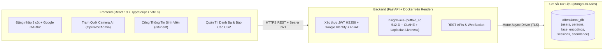

# EduFace — Hệ Thống Điểm Danh Sinh Trắc Học Khuôn Mặt AI

<p align="center">
  <strong>Website chính thức:</strong> <a href="https://dhv-edu.tech">https://dhv-edu.tech</a> ·
  <strong>API Docs (Swagger):</strong> <a href="https://eduface-system.onrender.com/docs">https://eduface-system.onrender.com/docs</a> ·
  <strong>Tác giả:</strong> <a href="https://github.com/maitamdev">maitamdev</a>
</p>

---

## 1. Giới Thiệu Dự Án

**EduFace** là nền tảng quản lý điểm danh học đường bằng công nghệ nhận diện khuôn mặt trí tuệ nhân tạo (**InsightFace `buffalo_sc` 512-D**), giúp biến bất kỳ laptop có webcam của giảng viên hoặc thiết bị di động thành trạm điểm danh sinh trắc học thời gian thực.

Toàn bộ dữ liệu sinh trắc học, phiên học phần và nhật ký chuyên cần được đồng bộ trực tiếp trên **MongoDB Atlas**, phục vụ đồng thời **3 nhóm người dùng** trong môi trường đại học:
1. **Quản trị viên / Giáo vụ khoa (`Admin`)**: Quản lý danh bạ sinh viên, đăng ký khuôn mặt, theo dõi biểu đồ chuyên cần, lọc danh sách sinh viên vắng quá `25%` (cảnh báo cấm thi) và xuất báo cáo Excel/CSV.
2. **Giảng viên (`Operator`)**: Mở ca học phần đầu giờ, bật Camera laptop quét khuôn mặt sinh viên (chế độ chụp đơn hoặc tự động quét `3.5 giây/lần`), đóng ca cuối giờ và tra cứu nhật ký điểm danh.
3. **Sinh viên (`Student`)**: Đăng nhập nhanh bằng **Google (`@gmail.com` / `@dhv.edu.vn`)**, tự khai báo **Họ tên + Mã số sinh viên (MSSV) + Lớp học phần + Chụp ảnh khuôn mặt lần đầu**, và theo dõi tỷ lệ chuyên cần cá nhân (`%`), giờ quét mặt thực tế cùng độ tin cậy AI của từng buổi học.

---

## 2. Kiến Trúc Hệ Thống & Công Nghệ Sử Dụng



| Tầng (Layer) | Công nghệ chính | Chi tiết kỹ thuật |
| :--- | :--- | :--- |
| **Frontend** | React 19, TypeScript, Vite 8, Tailwind CSS v4 | Giao diện đa ngôn ngữ (`VI` / `EN`), chế độ Sáng / Tối (`Light` / `Dark`), hỗ trợ đăng nhập Google OAuth2 (`Google Identity Services`). Triển khai trên **Vercel** tại [`https://dhv-edu.tech`](https://dhv-edu.tech). |
| **Backend API** | Python 3.11, FastAPI, Uvicorn, SlowAPI | Kiến trúc bất đồng bộ (`async/await`), phân quyền 3 vai trò (`admin`, `operator`, `student`), giới hạn tần suất (`Rate Limiting`), kiểm tra tệp ảnh an toàn bằng Pillow. Triển khai bằng **Docker** trên **Render**. |
| **AI Computer Vision** | InsightFace (`buffalo_sc`), ONNX Runtime, OpenCV, NumPy | Cân bằng sáng cục bộ **CLAHE**, kiểm tra độ sắc nét chống ảnh mờ bằng phương sai **Laplacian**, trích xuất vector đặc trưng **512 chiều (`float32`)** chuẩn hóa L2, so khớp tốc độ cao bằng tích vô hướng ma trận (**Cosine Similarity**). |
| **Database** | MongoDB Atlas (`Motor` Async Driver) | Lưu trữ trên đám mây với các chỉ mục chống trùng lặp (`Unique Compound Index (person_id, session_id)` ngăn điểm danh 2 lần trong cùng một ca học). |

---

## 3. Quy Trình Nghiệp Vụ Cốt Lõi

### 3.1. Đăng nhập Google & Khai báo Hồ sơ Khuôn mặt lần đầu (Dành cho Sinh viên)
- Sinh viên truy cập [`https://dhv-edu.tech/login`](https://dhv-edu.tech/login) và bấm **"Tiếp tục với Google"**.
- Nếu là lần đầu đăng nhập, hệ thống tự động khởi tạo tài khoản `student` và mở biểu mẫu **Khai báo thông tin sinh viên & Đăng ký khuôn mặt lần đầu** ngay tại `/student`:
  - Nhập **Họ và tên**, **Mã số sinh viên (MSSV)**, **Lớp / Học phần** (ví dụ: `KTCN`).
  - Bật Camera chụp trực tiếp từ **1 đến 5 ảnh khuôn mặt** (hoặc tải ảnh từ thiết bị).
- Hệ thống kiểm tra chất lượng ảnh (`det_score >= 0.60`), kiểm tra chống trùng khuôn mặt (`DUPLICATE_THRESHOLD = 0.45`), lưu vector 512 chiều và liên kết vĩnh viễn với tài khoản Google của sinh viên.

### 3.2. Mở ca học phần & Điểm danh trực tiếp tại lớp (Dành cho Giảng viên)
- Đầu buổi học, giảng viên vào mục **Phiên điểm danh (`/sessions`)** tạo ca mới (ví dụ: `Buổi 1 - Lý thuyết`, Lớp `KTCN`).
- Mở mục **Máy quét AI trực tiếp (`/scanner`)**, chọn ca đang mở và bật Camera laptop.
- Sinh viên lần lượt nhìn vào Camera: AI nhận diện trong `< 300ms`, tự động ghi nhận trạng thái **Có mặt (`present`)**, thời gian thực tế (`marked_at`) và độ khớp AI (`confidence`). Nếu sinh viên quét lại lần 2 trong cùng buổi học, hệ thống thông báo **"Đã điểm danh trước đó"** và không ghi trùng.

### 3.3. Theo dõi chuyên cần & Cảnh báo cấm thi (Dành cho Sinh viên & Quản trị viên)
- **Trên Cổng Sinh viên (`/student`)**: Sinh viên xem tổng số buổi học của lớp, số buổi có mặt, số buổi vắng mặt, tỷ lệ chuyên cần (`%`) và cảnh báo nếu dưới ngưỡng **75%**.
- **Trên trang Báo cáo (`/reports`)**: Quản trị viên xem biểu đồ chuyên cần theo chuỗi 7/14/30/90 ngày, ma trận **Heatmap 14 ngày**, lọc danh sách sinh viên vắng quá `25%` (`is_defaulter`) và tải xuống file **CSV (UTF-8)** phục vụ xét điều kiện dự thi.

---

## 4. Hướng Dẫn Chạy Thử Tại Máy Cục Bộ (Local Development)

### 4.1. Khởi chạy Backend (`http://localhost:8000`)
```bash
cd backend
python -m venv .venv
.venv\Scripts\activate
pip install -r requirements.txt
uvicorn main:app --host 0.0.0.0 --port 8000 --reload
```

### 4.2. Khởi chạy Frontend (`http://localhost:5173`)
```bash
cd frontend
npm install
npm run dev
```

### 4.3. Chạy Bộ Kiểm Thử Tự Động (Unit & Integration Tests)
```bash
# Kiểm thử Backend (Pytest)
cd backend
pytest -q

# Kiểm thử & Build Frontend (Vitest + TypeScript)
cd frontend
npx vitest run
npm run build
```

---

## 5. Cấu Trúc Thư Mục Chính

```text
eduface-system/
├── backend/
│   ├── core/
│   │   ├── auth.py               # Xác thực JWT HS256, băm mật khẩu scrypt & phân quyền RBAC
│   │   ├── azure_face.py         # Pipeline AI InsightFace (buffalo_sc 512-D), CLAHE, Liveness
│   │   ├── database.py           # Kết nối MongoDB Atlas (Motor) & khởi tạo Indexes
│   │   ├── google_identity.py    # Xác thực Google OAuth2 / OpenID Connect
│   │   ├── schemas.py            # Các mô hình dữ liệu Pydantic v2
│   │   └── validation.py         # Kiểm tra an toàn tệp ảnh tải lên (Pillow)
│   ├── routers/
│   │   ├── auth.py               # API đăng nhập, quản lý tài khoản & Cổng sinh viên (/student-portal)
│   │   ├── google_auth.py        # API đăng nhập Google & tự động khởi tạo tài khoản sinh viên
│   │   ├── persons.py            # API đăng ký khuôn mặt (Admin & Sinh viên tự đăng ký /self-enroll)
│   │   ├── sessions.py           # API mở/đóng phiên điểm danh học phần
│   │   ├── attendance.py         # API nhận diện khuôn mặt, ghi điểm danh & xuất CSV
│   │   ├── dashboard.py          # API thống kê tổng quan & hoạt động gần đây
│   │   └── reports.py            # API báo cáo chuyên cần, Heatmap & lọc sinh viên cấm thi
│   ├── tests/                    # Bộ kiểm thử tự động Backend (Pytest)
│   ├── Dockerfile                # Cấu hình đóng gói Docker chạy trên Render
│   └── main.py                   # Điểm khởi chạy ứng dụng FastAPI & CORS
└── frontend/
    ├── src/
    │   ├── api/client.ts         # Tầng giao tiếp REST API kèm JWT Bearer
    │   ├── auth/google.ts        # Tích hợp Google Identity Services
    │   ├── components/           # AppShell, RouteGuards, ProductUI
    │   ├── context/              # AuthContext, LanguageContext (VI/EN), ThemeContext (Light/Dark)
    │   └── pages/                # LoginPage, DashboardPage, LiveScannerPage, StudentPortalPage, ...
    ├── vercel.json               # Cấu hình định tuyến SPA trên Vercel
    └── vite.config.ts            # Cấu hình đóng gói Vite 8
```

---

<p align="center">
  <strong>EduFace · Hệ thống quản lý điểm danh nhận diện khuôn mặt AI</strong><br/>
  Design and coding by <a href="https://github.com/maitamdev"><strong>maitamdev</strong></a>
</p>
