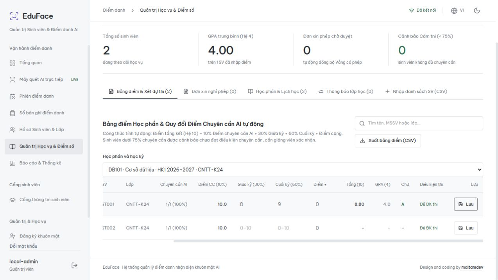

# Báo cáo khắc phục và nâng cấp EduFace

**Ngày:** 27/10/2026 · **Workspace:** `D:\project\AI-Attendance-System` · **Mốc Git:** `162a61b` cùng các thay đổi có sẵn trước lần sửa.

## 1. Kết quả và phạm vi

Đã trực tiếp sửa mã nguồn, nâng cấp luồng học vụ/bảo mật/vận hành và kiểm tra bằng unit test, MongoDB thật, SDK HTTP thật và trình duyệt. Không dùng sub-agent. Không push, deploy hay publish. Không mở/chỉnh sửa DB thật của người dùng; môi trường nghiệm thu dùng MongoDB 8.0.34 replica set chỉ lắng nghe localhost và DB thử riêng.

**Không thể kết luận “dự án hết mọi lỗi” hoặc “đã sẵn sàng production 100%”.** Những lỗi xác định được đã xử lý hoặc thu hẹp có kiểm chứng; các điều kiện chưa được kiểm định được nêu rõ ở mục 5. Đặc biệt: operator chưa có phân công lớp; PAD/độ chính xác khuôn mặt chưa được đánh giá trên người thật; dữ liệu lịch sử không đủ thông tin không được tự suy đoán để sửa.

Đã giữ các sửa đổi có sẵn. Bản sao trước thay đổi: `D:\project\AI-Attendance-System-before-fixes-20261027-002122` (gồm source đã sửa trước đó và `working-tree.patch`). Báo cáo audit ban đầu [BAO_CAO_TOAN_DIEN.md](BAO_CAO_TOAN_DIEN.md) được giữ làm mốc so sánh.

## 2. Đối chiếu 20 phát hiện ban đầu

| Mã | Kết quả sửa | Trạng thái / giới hạn |
|---|---|---|
| F01 | Self-enroll đọc tài khoản đã xác thực và `users.person_id`; bỏ liên kết theo email liên hệ | Đã sửa, regression đạt |
| F02 | Chụp lại giữ `enrolled_at`, cập nhật `face_updated_at`; giữ thông tin giáo vụ; phiên mới có roster snapshot | Đã sửa cho dữ liệu mới; roster quá khứ thiếu thông tin cần đối chiếu |
| F03 | Điểm theo sinh viên + học phần; học phần có học kỳ/lớp; chọn môn trên UI; GPA theo tín chỉ | Đã sửa; điểm cũ chưa gắn môn chỉ đọc |
| F04 | Bỏ email admin/client ID Google cố định; không nâng quyền theo email hồ sơ hoặc username | Đã sửa nguồn; liên kết admin đã tồn tại trong DB cần rà soát |
| F05 | Login giới hạn tần suất; mật khẩu mới ≥12; import mật khẩu riêng; demo opt-in; đổi mật khẩu thu hồi JWT cũ | Đã sửa; không tự thay mật khẩu tài khoản thật có sẵn |
| F06 | Liveness lỗi/ảnh trống không cho qua; mark bắt buộc probe; enroll ảnh nhiều mặt bị từ chối | Đã sửa nhánh lỗi; chưa là PAD được chứng nhận, chưa chống mọi replay |
| F07 | So sánh cosine thô, sàn server không thể bị client hạ; bỏ boost điểm; UI ghi rõ cosine | Đã sửa logic; chưa có FAR/FRR thực nghiệm |
| F08 | Dashboard đếm distinct người hoạt động, gồm present/late/excused; nhãn số liệu đúng đơn vị | Đã sửa, test Mongo thật đạt |
| F09 | SDK sửa URL, multipart, vai trò và response; live smoke backend thật đạt | Đã sửa trong workspace; chưa publish/version bump |
| F10 | Mark/manual kiểm tra đúng roster của phiên; truy cập student theo explicit link | Chỉ hoàn thành một phần: operator vẫn có quyền vận hành toàn hệ thống |
| F11 | Index MSSV/account/grade/course; transaction cho luồng ghi nhiều bước; rollback và cạnh tranh ghi | Đã sửa; cần replica set và migration dữ liệu cũ |
| F12 | HTTP/WS dùng allowlist origin rõ ràng, bỏ wildcard mọi subdomain Vercel | Đã sửa, tests policy/WS đạt |
| F13 | Root/backend .dockerignore; Docker COPY tường minh, non-root, health theo PORT | Đã sửa source; chưa build image Linux/Docker |
| F14 | CSV escape công thức; import parser xử lý dấu phẩy, xuống dòng, quote và báo dòng lỗi | Đã sửa, frontend tests đạt |
| F15 | Attendance/sessions có offset; UI tải nhiều trang; export stream không cắt 10.000; portal bỏ cap100 | Đã sửa cắt dữ liệu; UI/aggregate lớn vẫn cần đo tải và phân trang phía server sâu hơn |
| F16 | Cache matrix/TTL, khóa cold-init; metrics thật; health kiểm tra DB/model; liveness riêng | Đã sửa; cache giữa nhiều instance có thể chậm tối đa TTL |
| F17 | Consent khi enroll; audit mutation và trước/sau ở các luồng chính; xóa embedding + hàng đợi xóa ảnh | Hoàn thành phần code; audit chưa bất biến, Blob/backup retention chưa nghiệm thu cloud |
| F18 | Các panel học vụ báo lỗi và retry thay vì âm thầm trả rỗng | Đã sửa; preview cập nhật endpoint mới |
| F19 | Đóng phiên transaction/idempotent; giữ mốc tạo khi sửa điểm danh; lưu updated_at/by | Đã sửa, rollback/retry thực tế đạt |
| F20 | CLI chạy được; requirements trực tiếp được pin; publish chỉ manual và không nuốt lỗi; README/upgrade guide cập nhật | Đã sửa; wiki cũ đánh dấu tham khảo; CI mới chưa chạy trên GitHub |

## 3. Nâng cấp thêm trong quá trình kiểm tra

- **Công cụ migration có dry-run**: báo ID xung đột trước thay đổi, chuẩn hóa MSSV/session ID, thay index tên bằng định danh; không gộp người hoặc gán môn học tự động. Đã kiểm tra trên MongoDB thật cả thành công và chặn dữ liệu mơ hồ.
- **Sửa kết nối MongoDB cục bộ**: truyền `tlsAllowInvalidCertificates=False` vẫn khiến driver bật TLS. Đã bỏ tùy chọn dư thừa; TLS/kiểm tra chứng chỉ theo URI và mặc định driver, Atlas tiếp tục dùng TLS. Đã tái hiện và xác nhận `/health` healthy trên localhost.
- **Google cấu hình thống nhất**: frontend tôn trọng cấu hình backend, không tự bật bằng client ID dự phòng khi backend tắt.
- **JWT chỉ tồn tại theo phiên trình duyệt**: sessionStorage, xóa bản localStorage cũ; production không dùng VITE_API_KEY.
- **Ảnh enrollment upload sau commit**: tránh tạo ảnh cloud khi transaction DB rollback. Ảnh mặc định không lưu; nếu người dùng xóa hồ sơ trong lúc upload thì chuyển sang cleanup.
- **Dữ liệu legacy**: đọc cả ObjectId và string session ID; manual update không tạo một bản ghi thứ hai cho cùng phiên legacy.
- **Trải nghiệm**: khóa chỉnh thông tin giáo vụ khi chụp lại; dữ liệu cũ chỉ đọc; đổi học phần xóa draft cũ; tải thông tin tài khoản nhập CSV; mẫu đồng ý xử lý khuôn mặt; loại các nhãn coi hồ sơ nhập CSV là đã xác thực bằng camera. Ngày đơn nghỉ theo múi giờ UTC+7.
- **Công cụ đo AI**: `evaluate_similarity.py` nhận CSV ground truth và điểm similarity để tính FAR/FRR, p50/p95. Chưa có tập validation thật được cung cấp.

## 4. Kiểm chứng thực tế

| Hạng mục | Kết quả | Bằng chứng |
|---|---|---|
| Backend toàn bộ, bật Mongo integration | **195 passed**, 0 failed/0 skipped; 1 warning deprecation của Starlette/httpx | [Log](fix-backend-final.txt) |
| MongoDB integration trong số 195 ca | **9 ca**: rollback import/close, uniqueness, grade/report/history, CSV 10.005 dòng, password/token/rate-limit, migration, legacy ID, concurrent mark/retry | `backend/tests/test_mongo_integration.py` |
| Frontend | **26 passed** | [Log](fix-frontend-tests-final.txt) |
| TypeScript frontend + production build | Đạt | [Log](fix-frontend-final.txt) |
| Packages JS/TS | **31 passed**; build/typecheck đạt | [Log](fix-packages-tests.txt) |
| Package Python | **4 passed** | [Log](fix-python-package.txt) |
| SDK tới HTTP backend thật + model thật | Đạt auth, session, reports, dashboard, CSV, nhận diện/mark ảnh trống, từ chối enrollment không có mặt | [Log](fix-sdk-live.txt) |
| CLI | `--help` chạy; username/password yếu bị từ chối trước truy cập DB | [Validation](fix-cli-validation.txt) |
| npm audit root và frontend | 0 cảnh báo CVE đã biết tại thời điểm chạy | [Root](fix-npm-audit-root.json), [frontend](fix-npm-audit-frontend.json) |
| Python audit | 0 lỗ hổng đã biết trong requirements đã kiểm tra | [Log](fix-pip-audit.txt), [JSON](fix-pip-audit.json) |
| Cú pháp Python, YAML CI, git diff --check | Đạt; không lỗi whitespace | [Diff check](fix-diff-check.txt) |

MongoDB tải từ kênh chính thức, đã xác minh SHA256 trước chạy. Fixture tạo DB tên ngẫu nhiên và xóa đúng DB đó. Bộ concurrency chấp nhận write conflict trả 503 để retry, cuối cùng chỉ có một attendance record; không quảng cáo rằng mọi yêu cầu đồng thời đều nhận 200 ngay lần đầu.

**Trình duyệt với bản build production và dữ liệu giả:** đăng nhập admin thử, dashboard 2 người/2 phiên/4 lượt nhưng tỷ lệ 100%; lưu điểm DB101 giữa kỳ8/cuối kỳ9 cho tổng8.80/GPA4.0; đổi WEB101 thấy điểm trống; cổng sinh viên đối chiếu GPA4.00 trên3 tín chỉ và2/2 buổi. Lỗi HMR context xuất hiện khi sửa source trong lúc dev server đang chạy, biến mất khi reload bản production; không dùng lỗi đó làm bằng chứng bản production hỏng.

## 5. Các việc còn phụ thuộc môi trường/dữ liệu thật

1. **Quyền operator theo lớp chưa được triển khai.** Chỉ dùng operator cho nhân viên được phép vận hành toàn hệ thống. Nếu cần mô hình giảng viên phụ trách lớp, phải thêm phân công lớp và áp dụng scope đồng nhất cho tất cả API.
2. **Chưa kiểm định accuracy/PAD.** Hai frame và heuristic không chứng minh người thật, không xác thực nguồn camera. Chưa có validation độc lập, FAR/FRR, spoof benchmark hay p95 dưới tải. Smoke ảnh trống không thay thế những phép đo này.
3. **Trọng số InsightFace có điều kiện sử dụng riêng.** Không mặc nhiên dùng giấy phép mã nguồn MIT để kết luận quyền sử dụng model thương mại; đối chiếu nguồn cấp phép chính thức.
4. **Chưa dùng OAuth/Blob thật và chưa build Docker/Linux.** Cấu hình frontend/backend/tenant/redirect/CORS, cleanup ảnh, quyền DB, backup và restore cần nghiệm thu trong môi trường mục tiêu.
5. **Dữ liệu cũ cần migration và đối chiếu.** Không thể khôi phục chính xác roster, enrolled_at đã bị ghi đè hoặc môn của điểm cũ nếu không có bản gốc. Liên kết Google/mật khẩu demo cũ không tự biến mất khi cập nhật code.
6. **Audit/retention và quy mô lớn** còn giới hạn như hướng dẫn nâng cấp: audit không bất biến, không có invalidation liên instance, UI giữ nhiều trang trong RAM, các báo cáo tổng hợp chưa benchmark quy mô thực.

## 6. Sử dụng kết quả bàn giao

Đọc [hướng dẫn nâng cấp](../../UPGRADE_2026_10.md), chạy migration dry-run trên bản sao dữ liệu, cấu hình môi trường thử và nghiệm thu các mục còn lại trước triển khai. Đã dừng API/Vite/MongoDB và đóng tab do tôi tạo; DB UI thử đã được xóa, chỉ giữ source/log/bằng chứng. Các thay đổi đã nằm trong workspace; chưa commit/push/deploy/publish. Có thể xem diff hiện tại để rà soát cùng các thay đổi người dùng đã có trước đó.
