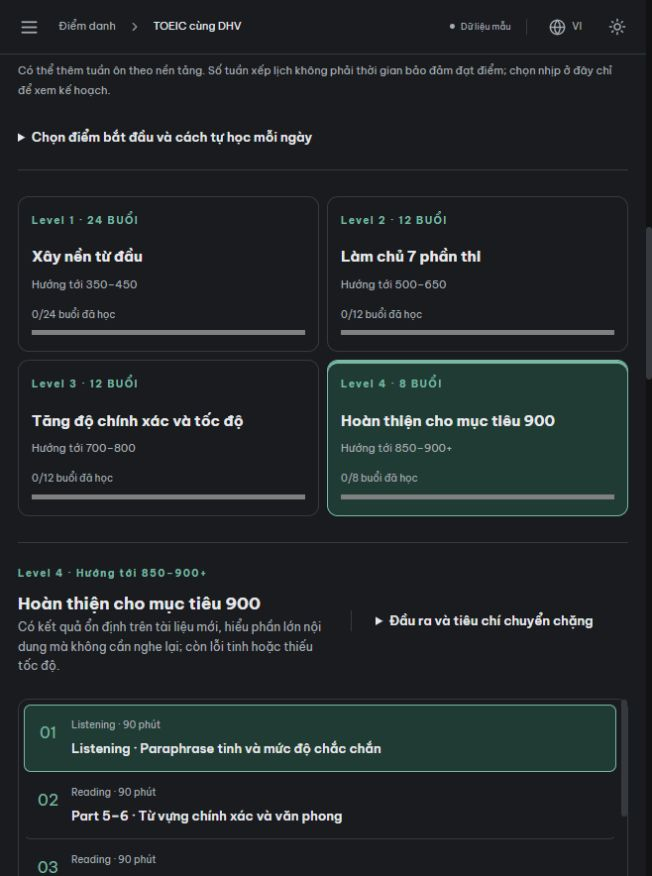

# Lộ trình TOEIC 56 buổi — kết quả kiểm chứng

## Yêu cầu và kết quả

Giữ đúng khung 24 buổi Level 1, 12 buổi Level 2 do người dùng cung cấp; thêm 12 buổi Level 3 và 8 buổi Level 4 cho mục tiêu cao hơn. Mỗi buổi có mục tiêu, kiến thức, ví dụ, 2 câu tự kiểm tra có giải thích, nhiệm vụ luyện, bài tập về nhà, từ/cụm trọng tâm, nguồn học và mốc đánh giá phù hợp.

- 56 buổi, 112 ví dụ phân tích, 112 câu tự kiểm tra, 85,5 giờ trong buổi.
- UI chọn level, chọn nhịp tuần, xem từng buổi, mở bài hỗ trợ, tải Markdown, tự kiểm tra và lưu đánh dấu buổi theo JWT.
- Đối chiếu 8 kho code cùng nguồn ETS/IIBC, British Council, Cambridge, IIG. Không nhập đề hoặc audio thương mại. Một repo công khai được loại vì license proprietary; một repo thiếu file cấp phép riêng chỉ được tham khảo ý tưởng.
- [Lộ trình đầy đủ](../../toeic/LO_TRINH_CHI_TIET.md), [thiết kế và phạm vi](../../toeic/THIET_KE_CHUONG_TRINH.md), [nghiên cứu nguồn](../../toeic/SOURCES.md).

## Kết quả kiểm tra tại máy phát triển

| Kiểm tra | Kết quả |
|---|---|
| Toàn bộ unit/backend suite | 234 passed; 20 integration tách chạy riêng |
| MongoDB replica set thật, localhost:27028 | 20 passed, gồm 2 bài mới về lưu buổi học |
| Toàn bộ frontend | 54 passed |
| TypeScript và Vite build | Thành công |
| Validate học liệu/media/30 cách ghép đề | Thành công; 56 buổi, 112 tự kiểm tra, media cũ đầy đủ |
| So dữ liệu bài cũ với commit trước thay đổi | 20 bài, 268 câu, 200 thẻ giữ nguyên nội dung và ID |
| Kiểm tra giao diện trình duyệt thật | Chọn Level 2/4, đổi nhịp sang 2 buổi cho 28 tuần, mở buổi rút gọn, trả lời 2/2 và hiện giải thích, mở/quay về từ bài hỗ trợ |
| Giao diện màn hình hẹp | Đã quan sát bố cục 2 cột level, danh sách buổi cuộn và nội dung một cột trong in-app browser |

Integration sử dụng database ngẫu nhiên `eduface_integration_*` trên MongoDB tạm chỉ bind localhost; fixture chỉ dọn database do test tạo. Không seed, xóa hoặc sửa hồ sơ sinh viên thật. Kiểm thử hoàn tất gồm việc ghi đồng thời hai buổi, thử lại không trùng, bỏ đánh dấu, tách tài khoản và giữ mục tiêu học đã lưu.

## Phạm vi thực tế

112 câu mới là **tự kiểm tra kiến thức dạng chữ**, không phải 112 câu nghe mới có audio. Ngân hàng chấm server vẫn 268 câu; bài hỗ trợ có thể được dùng chung giữa các buổi. Nhiệm vụ luyện ở mỗi buổi có thể yêu cầu tài nguyên từ nguồn liên kết. Đánh dấu đã học không tạo điểm TOEIC hay chứng chỉ. Mục tiêu 900 không được bảo đảm bởi số buổi hoặc phần trăm đúng nội bộ.

Trạng thái triển khai production được xác nhận riêng sau khi push: frontend cần có file tải lộ trình mới; API catalog phải trả curriculum đủ 56 buổi và backend vẫn khỏe. Frontend có dự phòng cho catalog cũ trong giai đoạn cập nhật backend.
