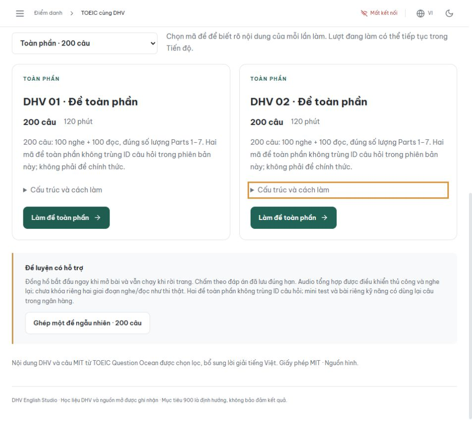
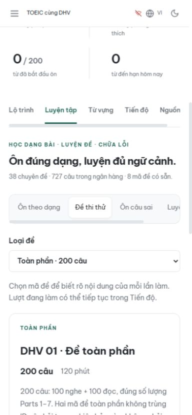

# Báo cáo mở rộng học và ôn TOEIC

Phạm vi: tiếp nối bản lộ trình tại commit `178a799`, triển khai yêu cầu tăng kiến thức, ôn các dạng và thêm đề thi thử. Thực hiện trực tiếp trong EduFace, không dùng subagent.

## Kết quả

- **727 câu chấm điểm**, tăng 459 câu: 399 câu MIT chuyển thể có lời giải tiếng Việt và 60 câu DHV mới.
- **38 chuyên đề** với kiến thức, các bước xử lý, bẫy, ví dụ giải mẫu và bài luyện theo dạng.
- **27 bài trong thư viện**, giữ nguyên 20 bài và nội dung 268 câu cũ; thêm nhãn kỹ năng để sử dụng lại trong ôn dạng.
- **8 mã đề cố định**: 2 đề 200 câu/120 phút, 4 mini 50 câu/35 phút, 1 Listening 100 câu/45 phút và 1 Reading 100 câu/75 phút. Hai đề toàn phần không trùng ID câu.
- **Sổ câu sai riêng cho tài khoản**, từ 50 lượt nộp mới nhất, có lọc Part và luyện lại nguyên nhóm ngữ cảnh.
- **188 WAV**, 18 hình, bảng/lịch nghe có thể đọc trên điện thoại, sổ tay 38 chuyên đề tải về.
- Giữ nguyên nội dung **56 buổi**, 112 câu tự kiểm tra, 200 thẻ từ, tiến độ cũ và cơ chế FSRS.

Danh sách câu từng mã được lưu riêng, không tự đổi khi ngân hàng tăng. Bài theo dạng giới hạn 15 câu; bài chuyên đề lớn và lượt ôn sai giới hạn 30 câu, luôn giữ đủ đoạn/hội thoại. Lưu và tiếp tục bài, request ID chống tạo trùng, đồng hồ và chấm điểm phía server tiếp tục áp dụng cho các kiểu mới. Không cần seed học liệu vào MongoDB hoặc gọi API AI để vận hành.

## Nghiên cứu và chất lượng dữ liệu

Đối chiếu ETS, IIBC, British Council; nghiên cứu cách tổ chức ngân hàng/feedback của Moodle và H5P. Nguồn tái sử dụng thực tế là TOEIC Question Ocean MIT tại revision ghim cụ thể. Đã loại 15 câu ứng viên có vấn đề và không dùng 44 câu Part 6 cũ có nhóm không nhất quán. Có hai chỉnh sửa lựa chọn tiếng Anh được ghi nhận, giải thích tiếng Việt và attribution tới từng câu, giấy phép và hash của hình.

Chi tiết nguồn, lý do lựa chọn, số câu mỗi Part, danh mục mã đề và nơi sửa dữ liệu nằm trong [hướng dẫn ôn tập](../../toeic/MO_RONG_ON_TAP.md). [Thông báo giấy phép](../../toeic/CONTENT_LICENSES.md) phân biệt nội dung DHV, phần MIT và tài nguyên chỉ dẫn link.

## Kiểm chứng đã thực hiện

| Kiểm chứng | Kết quả |
|---|---|
| Toàn bộ backend, gồm MongoDB replica set cục bộ | **327 passed** |
| Frontend Vitest | **61 passed** |
| TypeScript + Vite production build | Thành công |
| Validator dữ liệu/media | 727 câu, 38 chuyên đề, 8 mã đề, 188 audio; hash và nhóm hợp lệ |
| Bảo toàn dữ liệu nền | Đối chiếu trực tiếp với Git HEAD: 268 câu không đổi câu chữ/đáp án/audio, 20 bài, 200 thẻ, nội dung 56 buổi giữ nguyên |
| Hình Part 1 mới | Đã xem đủ 10 JPG, đối chiếu mô tả và lựa chọn |
| CI | Bổ sung suite thư viện/đề/sổ lỗi vào job kiểm thử Mongo |

Có một cảnh báo deprecation từ FastAPI/Starlette test client; không có bài kiểm thử thất bại. Cảnh báo này không được tính thành lỗi runtime đã sửa.

Thử bằng trình duyệt thật với **tài khoản QA và MongoDB cục bộ**, không ghi điểm lên tài khoản production:

1. Đăng nhập, mở TOEIC, tìm `bi dong` để tới chuyên đề có dấu tiếng Việt.
2. Mở luyện Part 3 kết hợp bảng; bảng Shipping options hiển thị đủ hàng/cột.
3. Audio thật tải thành công, duration 29,4 giây; đã phát và kiểm tra thời gian phát tăng, rồi dừng.
4. Chọn đáp án, lưu, về Tiến độ và tiếp tục; lựa chọn và trạng thái đồng bộ còn nguyên.
5. Nộp lượt 6 câu với 1 đáp án: chấm 1/6, mở lời giải/transcript; sổ lỗi có đúng 5 câu bỏ trống.
6. Ở viewport 390px: lọc hai đề toàn phần, mở DHV 02 được 200 câu với đồng hồ 120 phút, ảnh JPG mới tải đủ; trang không tràn ngang.
7. Kiểm tra chuyển focus bằng bàn phím giữa các thẻ đề và trả viewport về mặc định.

Ảnh là môi trường QA: model nhận diện khuôn mặt được bỏ qua trong fixture nên badge health toàn ứng dụng báo mất kết nối; API học tập vẫn chạy với auth/Mongo thật tại localhost. Đây không phải ảnh trạng thái production.

## Giới hạn được công bố trong sản phẩm

Audio tổng hợp có thể nghe lại và điều khiển thủ công; chưa khóa hai giai đoạn như thi thật. Các mã mini/phần kỹ năng dùng lại câu cùng ngân hàng, không phải 8 bộ câu hoàn toàn độc lập. Chưa chuẩn hóa độ khó hoặc quy đổi ra điểm TOEIC; học liệu chưa có thẩm định giáo viên độc lập. Việc giữ số câu theo 7 Part không được mô tả là tái tạo đầy đủ mọi quy tắc dạng con của đề ETS.

## Vị trí dữ liệu chính

- [Ngân hàng chạy thật](../../../backend/data/toeic/course.json).
- [Danh sách câu của từng mã đề](../../../backend/data/toeic/exam-forms.json).
- [Nguồn chuyên đề](../../../backend/scripts/toeic_topics.py).
- [Lời giải và danh sách loại câu nguồn](../../../backend/scripts/toeic_ocean_vi.py).
- [60 câu DHV bổ sung](../../../backend/scripts/toeic_extra_questions.py).
- [Hướng dẫn tái tạo và nguồn công khai](../../toeic/MO_RONG_ON_TAP.md).
