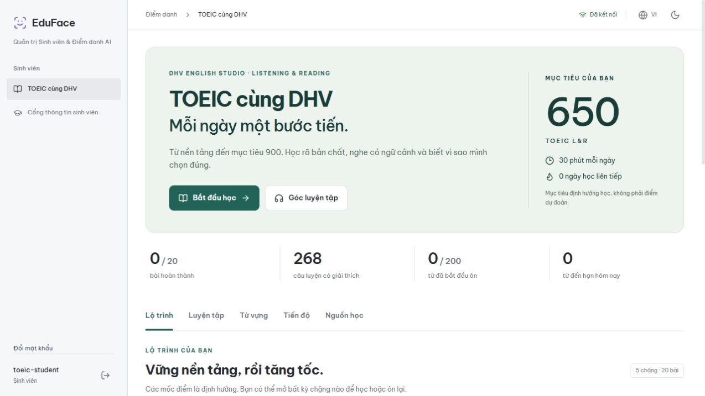
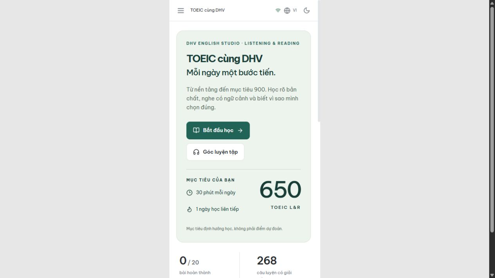

# Bàn giao tính năng “TOEIC cùng DHV”

Ngày 27/10/2026. Phạm vi: bổ sung góc học tiếng Anh vào EduFace hiện có. Toàn bộ công việc được thực hiện trực tiếp, không dùng sub-agent. Đã push và deploy theo yêu cầu tiếp theo của chủ dự án; xem [kết quả production](../reports/2026-10-27/DEPLOYMENT.md). Chưa phát hành package lên registry.

## Kết quả có thể sử dụng

Đã thêm tab **TOEIC cùng DHV** ở menu, đường dẫn `/toeic`, dùng được với student/operator/admin. Giao diện có lộ trình, luyện tập, từ vựng, tiến độ và nguồn học; tương thích bố cục màn hình nhỏ và giao diện sáng/tối.

- **5 chặng, 20 bài ngắn:** mục tiêu, kiến thức giải thích bằng tiếng Việt, ví dụ, cách luyện và từ vựng theo bài. Có thể học từ đầu hoặc mở chặng bất kỳ; bài đạt từ 70% được đánh dấu hoàn thành.
- **268 câu hỏi đủ 7 Part:** 8/32/42/33/54/20/79 câu theo Parts 1–7. Câu hỏi và lời giải được biên soạn mới; vị trí đáp án được phân bổ ổn định theo từng câu, không lặp vòng A/B/C dễ đoán.
- **200 thẻ từ:** nghĩa tiếng Việt, câu ví dụ tiếng Anh, tìm kiếm và lọc theo bài. FSRS 6.3.2 thực sự tính lịch ôn trên backend; lịch được lưu riêng từng tài khoản.
- **65 audio dựng sẵn:** WAV mono 16 kHz, tổng khoảng 17,75 phút/34,09 MB. Không cần API key hay dịch vụ TTS khi chạy bài nghe. Có 8 SVG tự tạo cho Part 1.
- **Ba hình thức luyện:** khảo sát 25 câu/25 phút; luyện từng Part; đề 200 câu/120 phút đúng số lượng câu từng phần và giữ trọn nhóm hội thoại/bài đọc.
- **Lưu và tiếp tục:** tự lưu đáp án, mở lại bài từ Tiến độ, theo dõi thời gian máy chủ, đánh dấu câu cần xem lại, nộp bài rồi xem đáp án/giải thích/transcript. Có trạng thái lỗi mạng và thử lại.
- **Tiến độ:** mục tiêu điểm và số phút học mỗi ngày, chuỗi ngày học theo giờ Việt Nam, điểm tốt nhất mỗi bài, 20 lượt gần nhất, nhật ký 90 ngày có hoạt động gần nhất, gợi ý Part cần củng cố.

## Nghiên cứu đã áp dụng

Đã xem py-fsrs, ts-fsrs, Moodle và một dự án từ vựng TOEIC Android. Chọn py-fsrs vì phù hợp Python backend và đồng bộ tài khoản. Không nhập code/học liệu từ repository chưa xác minh được giấy phép riêng; không dựng thêm một LMS nặng vào dự án hiện có.

Nguồn học được chọn gồm ETS/IIBC, IIG (English Discoveries, TOEIC OLPC, Academy), British Council và Cambridge. Các link chính thức, cách phối hợp theo chặng, quyền truy cập và ghi nhận trang IIG Academy trả HTTP 403 được trình bày trong [SOURCES.md](SOURCES.md). Không mua khóa học, không sao chép đề thương mại hay audio ETS.

## Cơ chế bảo vệ tính đúng của dữ liệu

1. JWT xác định người học; endpoint tiến độ không nhận user ID tùy ý từ client. Tài khoản khác không đọc, sửa hoặc nộp được attempt của người học. API key dùng chung không được ghi tiến độ cá nhân.
2. Bài chưa nộp không trả khóa đáp án, lời giải hoặc transcript. Điểm do server tính, không nhận điểm tự khai từ frontend. Snapshot câu hỏi được giữ trong attempt.
3. Revision chặn hai cửa sổ ghi đè lẫn nhau. Frontend xếp các yêu cầu lưu tuần tự; UUID và trạng thái nộp giúp thử lại mà không nhân đôi hoạt động học.
4. Bài quá hạn được chấm từ đáp án server đã lưu; thay đổi mới sau hạn không được tính. Có ba giây đệm lúc nộp. Số bài còn thời gian đang mở được giới hạn trong luồng tạo thông thường, và tạo bài có rate limit.
5. Nộp bài + cập nhật tiến độ, cũng như ôn từ + ghi nhật ký, dùng MongoDB transaction. Đã kiểm tra rollback khi cố tình làm một bước ghi lỗi.
6. Audio manifest ghi checksum transcript; validator phát hiện khi sửa nội dung mà quên dựng lại audio. Kiểm tra đủ file, định dạng, tín hiệu không rỗng và thứ tự lựa chọn trong transcript.

## Kiểm chứng thực tế

| Kiểm tra | Kết quả |
|---|---|
| Toàn bộ backend, có MongoDB replica set localhost thật | **222 passed**, 1 cảnh báo deprecation từ TestClient/httpx |
| Riêng TOEIC trong backend | **27 passed**: 18 kiểm tra nội dung/schema và 9 integration test |
| Toàn bộ frontend | **37 passed**, gồm 11 kiểm tra mới cho TOEIC và quyền route sinh viên |
| TypeScript + production build | Đạt; chunk TOEIC tải riêng khoảng 35,78 kB, gzip 10,97 kB |
| `pip-audit -r backend/requirements.txt` | Không phát hiện lỗ hổng đã biết tại thời điểm chạy |
| `npm audit --omit=dev --audit-level=moderate` | 0 vulnerabilities |
| Học liệu và media | 20 bài, 268 câu, 200 thẻ; đủ 65 audio và 8 hình; 30 cách ghép đề đạt kiểm tra |
| Trình duyệt với tài khoản student thật trong DB kiểm thử | Mở tab, đọc bài, phát audio, chọn đáp án, lưu/rời, tiếp tục giữ đáp án, nộp, xem lời giải, ôn từ và cập nhật lịch FSRS: đạt |
| Giao diện responsive | Đã xem trực tiếp desktop và khung iframe viewport 390px, sáng/tối |
| Bản build frontend | Có đủ 65 WAV; không chứa trang QA tạm |

Kiểm thử trình duyệt dùng tài khoản giả lập trong database local riêng `eduface_toeic_browser_20261027`, không dùng hoặc sửa database thật. Các integration test tạo/xóa database ngẫu nhiên do chính test sở hữu. Ảnh ở `screenshots/` minh họa giao diện và dữ liệu kiểm thử, không phải dữ liệu sinh viên thật.

Sau kiểm thử đã đóng tab QA, dừng các tiến trình API/Vite/MongoDB do lần kiểm thử này khởi chạy và xóa riêng database dùng một lần nêu trên. Không để lại tài khoản thử trong database của người dùng. Bạn chạy lại bằng cấu hình/tài khoản thật theo hướng dẫn; học liệu và audio vẫn có đầy đủ trong dự án.

CI đã thêm dependency FSRS, validator học liệu/media và integration test TOEIC. Docker backend đã bao gồm `data/toeic`; dữ liệu tĩnh và audio không cần seed MongoDB.

## Giới hạn cần hiểu đúng

- Đây là bộ khởi đầu tự học có thể mở rộng, **không phải một khóa đào tạo đầy đủ được kiểm định bảo đảm từ mất gốc lên 900**. Nội dung có hỗ trợ AI khi biên soạn; cần giáo viên rà soát thêm nếu dùng cho đánh giá chính thức.
- Không có điểm TOEIC dự đoán. Khảo sát ngắn chỉ gợi ý chặng học nội bộ; kết quả hiển thị số câu đúng và phần trăm.
- Đề 200 câu là chế độ luyện có hỗ trợ: audio tổng hợp điều khiển thủ công/nghe lại được, chưa cưỡng chế riêng 45 phút nghe và 75 phút đọc. Part 1 là minh họa vector. Các lượt đề có thể trùng do dùng cùng ngân hàng 268 câu.
- “Nghe từ” phụ thuộc giọng browser; nếu thiết bị không có giọng phù hợp, vẫn đọc được nghĩa/ví dụ và sử dụng audio chính đã đóng gói.
- Cần MongoDB replica set/Atlas để các thao tác nhiều collection commit an toàn. Không sửa cấu hình production hoặc chạy deployment trong lần bàn giao này.
- Chưa có chế độ offline hoàn chỉnh, quản trị viên biên tập học liệu qua UI, ghi âm/chấm phát âm, hoặc kỳ thi chống gian lận. Những chức năng này không được mô tả là đã hoàn thành.

## Bắt đầu chạy

Cập nhật dependency, chạy backend/frontend theo [README TOEIC](README.md), đăng nhập rồi mở `/toeic`. Dữ liệu đã nằm trong repository và bản build: không phải tải khóa trả phí hoặc nhập dữ liệu thủ công. Để chỉ xem giao diện khi chạy dev, mở `/design-preview/toeic`.

Tài liệu gồm [hướng dẫn chạy/mở rộng](README.md), [nguồn nghiên cứu và khóa học](SOURCES.md), [nguồn gốc và thông báo giấy phép](CONTENT_LICENSES.md), [kết quả kiểm tra nội dung](content-validation.json).

Trước khi thêm tính năng đã tạo bản sao các thay đổi hiện có tại `D:\project\AI-Attendance-System-before-toeic-20261027-011020` (135 file cùng patch/manifest). Các sửa chữa từ đợt trước được giữ lại; báo cáo này chỉ mô tả phần TOEIC mới.

