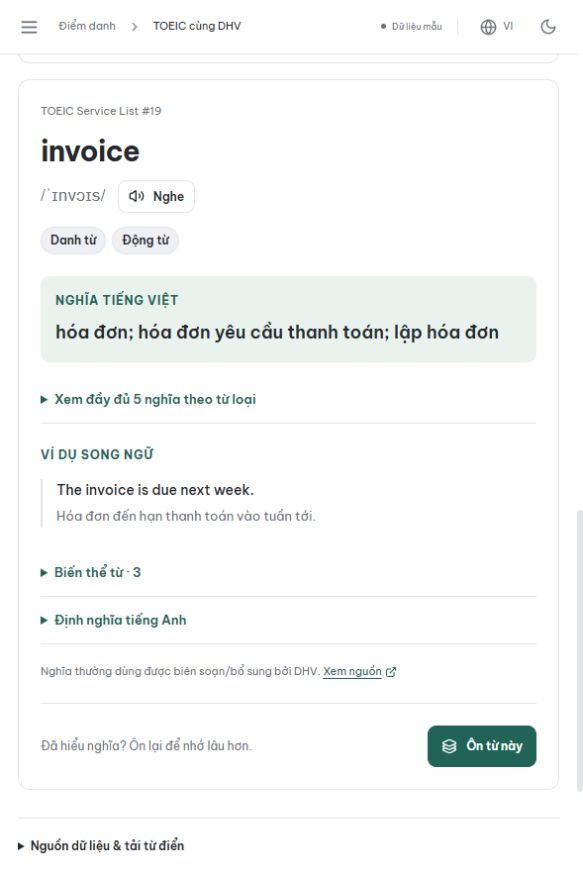

# Nâng cấp từ điển Anh–Việt DHV · 28/10/2026

Phiên bản dữ liệu: `dhv-dictionary-2026.10.28-v2`. Vào **TOEIC cùng DHV → Từ vựng → Từ điển Anh–Việt** để sử dụng. Kho từ được đóng gói sẵn, không cần API key dịch thuật hay nhập dữ liệu vào MongoDB.

## Những lỗi đã xử lý

- Tab từ vựng trước đây mặc định tìm trong 200 thẻ của bài học, khiến người học tưởng toàn bộ từ điển thiếu từ. Nay mở thẳng kho đầy đủ; bộ 200 thẻ có tên riêng, tìm tiếng Việt không dấu và nút chuyển nguyên từ khóa sang từ điển.
- Nghĩa tiếng Việt trước đây bị cắt ngắn, bỏ mất nghĩa phổ biến của một số từ. Nay giữ đầy đủ nghĩa theo từ loại, bổ sung các nghĩa thường dùng và ví dụ có bản dịch. Ví dụ: `accommodation` có “chỗ ở”; `love` có “tình yêu”; `hello` có “xin chào”.
- Tra cứu chuẩn hóa hoa/thường, dấu tiếng Việt, dấu nháy, dấu nối và khoảng trắng; nhận diện biến thể. Ưu tiên từ khớp chính xác, rồi biến thể, nghĩa tiếng Việt và các kết quả liên quan. Có gợi ý sửa lỗi chính tả để người học chọn.
- Bộ lọc được thu gọn nhưng có chỉ báo khi đang áp dụng. Khi bộ lọc che mất từ, giao diện báo rõ và cho tìm lại trong toàn bộ kho, giữ nguyên từ khóa.
- Tách **Tra từ** và **Ôn thẻ**. Khi ôn Việt → Anh, thẻ và danh sách không in sẵn đáp án tiếng Anh; mở đáp án trước khi chấm mức nhớ. Giữ lịch FSRS, phiên bản và mã chống ghi lặp khi thử lại.
- Hủy kết quả tìm kiếm cũ khi người học nhập từ khác; có báo lỗi, thử lại và giới hạn chờ khi mạng bị treo.
- Loại bỏ phiên âm đoán/ký tự hỏng của kho mở rộng. Từ thiếu IPA được ghi rõ; không quảng cáo toàn bộ kho có phiên âm Mỹ.
- Backend tra chỉ mục SQLite FTS5 trong luồng xử lý riêng, chỉ đọc chi tiết trang đang xem. Không nạp toàn bộ 191 nghìn bản định nghĩa vào mỗi request.
- Bản xem thử dùng Web Worker, chỉ tải phần chi tiết cần thiết. Kiểm tra kích thước và SHA-256 cho cả file gzip gốc lẫn nội dung đã được trình duyệt/CDN giải nén; tải lỗi không bị che thành một từ điển thiếu dữ liệu.

## Số liệu từ dữ liệu thực tế

| Thành phần | Số lượng |
|---|---:|
| Mục từ độc lập | 191.864 |
| Mục từ thêm so với bản 147.245 | 44.619 |
| Nghĩa tiếng Việt theo từ loại | 259.107 |
| Ví dụ có cả tiếng Anh và tiếng Việt | 24.576 |
| Mục có phiên âm từ dữ liệu nguồn/biên soạn hiện có | 84.898 |
| Mục được DHV bổ sung/biên soạn nghĩa trong đợt này | 133 |
| Mục mang nhãn nghĩa DHV `edited` (gồm phần đã có) | 763 |
| Mục mang nhãn nguồn cộng đồng `community` | 91.081 |
| Mục còn dùng nghĩa dịch máy `machine` | 100.020 |

Giữ toàn bộ **147.245 ID cũ**, 4.060 từ trọng tâm NGSL/TSL và 200 thẻ theo bài. Lịch ôn của người học không cần chuyển đổi hoặc xóa. Số lượng nghĩa/ví dụ là số bản ghi, không phải số mục từ mới hay số câu hỏi thi.

## Các ca tra cứu đã kiểm chứng

| Nhập | Kết quả mong đợi |
|---|---|
| `xin chào`, `xin chao` | `hello` với nghĩa Việt và ví dụ song ngữ |
| `tình yêu` | `love` |
| `hoa don` | `invoice` |
| `went` | `go`, có thông báo là biến thể |
| `studies` | `study` |
| `accomodation` | Gợi ý `accommodation`, không tự đổi từ khóa |
| `recieve` | Gợi ý `receive` |
| `social media` | Mục mới “mạng xã hội” |
| `résumé` / `resume` | Ưu tiên đúng cách viết người học nhập |
| Từ có trong kho nhưng bị lọc | Hiện nút tìm trong toàn bộ từ điển |

## Nguồn và chất lượng

- [NGSL 1.2](https://www.newgeneralservicelist.com/new-general-service-list) và [TOEIC Service List 1.2](https://www.newgeneralservicelist.com/toeic-service-list): giữ thứ hạng và ghi nguồn Charles Browne, Brent Culligan, Joseph Phillips theo từng bộ; CC BY-SA 4.0.
- [Wiktionary tiếng Việt](https://vi.wiktionary.org/) qua [Kaikki/Wiktextract](https://kaikki.org/dictionary/rawdata.html): nhập nghĩa tiếng Việt, từ loại, dạng từ và ví dụ có bản dịch; CC BY-SA 4.0. Từng mục có liên kết về nguồn.
- [thichhoc-dict](https://github.com/thichhoc-org/thichhoc-dict/tree/4d6e92e8bcf8e3e762410c2b0a9f98fea8e62e5b): giữ nội dung, ID và ghi nguồn của bộ đã tích hợp; phục hồi IPA thực sự có trong nguồn, bỏ IPA đoán. Nguồn công bố bản dịch máy chưa được người biên tập duyệt; giao diện hiển thị nhãn này.
- Phiên âm và thông báo giấy phép của ipa-dict (MIT), CMUdict (BSD 2-clause), Wiktionary và WordNet được giữ cùng dữ liệu. Phần DHV bổ sung được chia sẻ theo CC BY-SA 4.0.

Thông báo phân phối tại [`DICTIONARY.md`](../../frontend/public/toeic/licenses/DICTIONARY.md); URL tải nguồn, revision và SHA-256 tại [`dictionary-meta.json`](../../backend/data/toeic/dictionary-meta.json).

Với file nguồn dạng văn bản cũ, metadata giữ checksum gốc và thêm checksum bản chuẩn hóa xuống dòng LF của repository. Điều này cho phép kiểm tra chính xác sau khi Git checkout trên Windows hoặc Linux; các file nhị phân vẫn kiểm tra nguyên byte.

Kho rộng hơn nhưng **không phải mọi từ tiếng Anh đều có trong một từ điển**, và số lượng lớn không đồng nghĩa mọi bản dịch đã được giáo viên duyệt. Nhãn `edited/community/machine` mô tả nguồn nghĩa, không chứng nhận chính xác tuyệt đối. Không tự lấy bản dịch của từ gần giống để gán cho một từ chưa tìm thấy; giao diện dẫn sang Wiktionary khi cần tra thêm.

## Dữ liệu lưu ở đâu

| Đường dẫn trong repository | Vai trò |
|---|---|
| `backend/data/toeic/dictionary.sqlite3.gz` | Từ điển và chỉ mục phục vụ API; giải nén một lần vào cache tạm theo SHA-256, mở chỉ đọc |
| `backend/data/toeic/dictionary-meta.json` | Phiên bản, số lượng, nguồn, checksum và thống kê |
| `backend/scripts/toeic_dictionary_editorial.py` | 133 mục sửa/bổ sung nghĩa, ví dụ và bí danh tra cứu của DHV |
| `backend/scripts/import_toeic_dictionary.py` | Bộ nhập nguồn có ghim checksum, chuẩn hóa và tạo các bản phân phối |
| `frontend/public/toeic/dictionary/search.json.gz` | Chỉ mục dùng cho bản xem thử |
| `frontend/public/toeic/dictionary/entries-*.json.gz` | 375 phần dữ liệu chi tiết, mỗi phần tối đa 512 mục |
| `frontend/public/toeic/dictionary/dictionary.json.gz` | Bản tải đầy đủ, không chứa tiến độ cá nhân |
| `backend/data/toeic/lexicon.json`, `lexicon_100k.json.gz` | Đầu vào lịch sử, giữ để tái tạo ID; API mới đọc SQLite |

Lịch ôn, ngày học và mức nhớ tiếp tục nằm trong MongoDB theo tài khoản. Bộ từ tĩnh không chứa dữ liệu cá nhân.

## Tái tạo và kiểm tra

Ứng dụng dùng ngay các file đã commit. Chỉ khi biên soạn lại dữ liệu mới cần tải hai file trong `INPUTS` của importer vào một thư mục cục bộ. Script bắt buộc đúng SHA-256, chỉ đọc JSON/JSONL trong archive và không chạy code bên ngoài. Khi nguồn công khai thay đổi, cần chọn revision/snapshot mới và kiểm tra trước khi đổi checksum.

```powershell
.\backend\.venv\Scripts\python.exe -X utf8 backend/scripts/import_toeic_dictionary.py --source-dir C:/duong-dan/nguon-tu-dien
.\backend\.venv\Scripts\python.exe -X utf8 backend/scripts/build_toeic_content.py
.\backend\.venv\Scripts\python.exe -X utf8 backend/scripts/validate_toeic.py
```

Không cần chạy lại script từ điển cũ để sử dụng kho mới. Không cần migration, seed lại người dùng hoặc tải nguồn ở mỗi lần backend khởi động.

Kiểm chứng trong đợt này gồm bộ backend đầy đủ, kiểm thử React/TypeScript, dữ liệu thật trong bản xem thử, checksum nguồn/phân phối, build production và thao tác trình duyệt bằng tài khoản sinh viên trên MongoDB replica set riêng. Đã lưu một lượt ôn, tải lại trang và xác nhận lịch vẫn còn. Môi trường QA bỏ khởi động mô hình nhận diện khuôn mặt; biểu tượng health của mô hình ở môi trường này không dùng để kết luận tình trạng từ điển.

Kết quả: **378 kiểm thử backend**, **78 kiểm thử Vitest** và **5 kiểm thử parser nguồn** đạt. Chạy lại kiểm thử từ điển sau thay đổi cuối: 37 kiểm thử dữ liệu/tìm kiếm và 12 kiểm thử tích hợp MongoDB đạt. TypeScript, build production và bộ kiểm tra toàn bộ học liệu/checksum đạt.

Bản xem thử đã được mở trên trình duyệt thật: nhập `hoa don`, chọn `invoice`, xem nghĩa đầy đủ và ví dụ song ngữ. Ảnh kiểm chứng ở viewport rộng 583 px:


